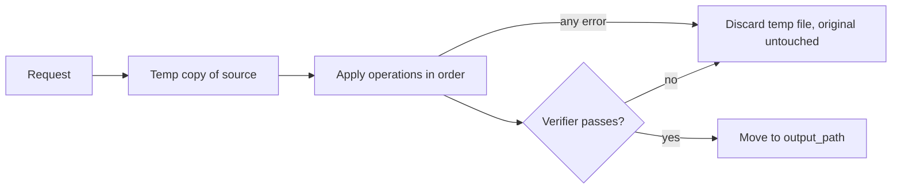

# vpp-mcp: Claude + Visual Paradigm

An [MCP](https://modelcontextprotocol.io) server that lets Claude **read and edit Visual Paradigm (`.vpp`) projects**: class diagrams (classes, interfaces, enumerations, attributes, operations, relationships) and sequence diagrams. No need to open the application.

[](https://github.com/Nikodem5/vpp-mcp/actions/workflows/tests.yml)
[](LICENSE)
[](pyproject.toml)

🇵🇱 [Wersja polska](README.pl.md)

Built for a university *Design Patterns* course (AGH), where every diagram is made in Visual Paradigm Community Edition. It helps with completing a class diagram, drawing a dozen sequence diagrams, and with design-pattern studies, i.e. "before" and "after" versions of a class diagram.

> Unofficial tool, not affiliated with Visual Paradigm. The file format was reverse-engineered from real projects and tested on **Visual Paradigm Community Edition 18.1 (build 20260914)**. The server never modifies your file: it always writes an edited **copy**. Keep your own backup anyway.

Note: tool descriptions and error messages returned by the server are currently in Polish. Claude handles this without trouble and answers in your language.

## What you can do with it

Example prompts for Claude:

- "Show me which classes and relationships are in `C:\...\project.vpp`."
- "Apply the Singleton pattern to the `DyspozytorDostaw` class and save it as `project-singleton.vpp`."
- "Add a Builder for `Zamowienie` and create a 'fragment after changes' diagram."
- "Draw a sequence diagram for the *Place order* use case based on the methods in the class diagram."
- "Export the `Zamowienie`, `Platnosc` and `BramkaPlatnosci` classes to PlantUML, I need a snippet for my report."

| Tool | What it does |
|---|---|
| `vpp_project_info` | Project summary: diagrams, number of classes, actors, use cases, whether the file is open in VP. |
| `vpp_list_classes`, `vpp_get_class` | Classes with attributes and operations in UML notation, the relationships of a class, its position on the diagram. |
| `vpp_list_relationships` | Generalizations, realizations, dependencies and associations with multiplicities and roles. |
| `vpp_get_sequence_diagram` | Participants, messages numbered as in VP (1, 1.1, ...), loop/alt/opt fragments with guards. |
| `vpp_export_plantuml` | A fragment of the class diagram as PlantUML. |
| `vpp_edit_class_model` | A batch of changes to the class model and class diagram: new classes, interfaces, enumerations and abstract classes (with a shape on the diagram), attributes and operations (also `static`, `abstract`, `List<...>`), changing and removing members, enumeration literals, **stereotypes** (`set_stereotype`, e.g. «Singleton»), relationships of every kind, removing relationships, moving and fitting class boxes, **automatic class layout** (`auto_layout`: classes do not overlap, lines do not run through other classes or cross each other; only selected classes can be moved), **orthogonal line routing** (`auto_route`, called by default after `auto_layout`: polylines with bends, spread-out line ends, multiplicity and role labels next to the ends), **new class diagrams** (`add_class_diagram`, optionally in a Model folder via `folder`) and **placing existing classes with their relationships on a chosen diagram** (`add_to_diagram`). Unknown fields and operations fail with an error instead of being silently ignored. |
| `vpp_list_patterns`, `vpp_apply_pattern` | **Creational patterns:** Singleton, Builder, Factory Method, Abstract Factory, Prototype. A pattern is applied to existing classes: it adds roles (classes, interfaces, stereotypes), members and relationships, and optionally draws a "fragment after changes" diagram. The result is a description of the pattern roles and a list of changes. |
| `vpp_add_sequence_diagrams` | Whole sequence diagrams from a description: actors, objects (including objects created mid-sequence and static calls), call, self, create, return, found, signal, loop/opt/alt fragments, `ref`. Messages are bound to operations from the class diagram. An optional `folder` per diagram puts it into a Model folder of the Model Explorer (created when missing; `Parent/Child` for nested). |
| `vpp_delete_sequence_diagram` | Deletes a sequence diagram, e.g. to regenerate it from scratch. |
| `vpp_render_diagram` | **PNG preview of a class diagram** drawn from the geometry stored in the file (classes with members, stereotypes, lines, diamonds, multiplicities, roles). It is not VP's renderer, but it uses the same positions, so you can judge the layout without opening the application. Needs Pillow (installed with the server). |
| `vpp_render_sequence` | PNG preview of a sequence diagram (lifelines, activations, numbered messages, loop/alt/opt fragments, ref). |
| `vpp_verify` | Structural check of the file. |

## How it works

A `.vpp` file is a SQLite database. Visual Paradigm stores every model and diagram element as one row whose `DEFINITION` column holds the element in VP's own text notation. There is no public specification, so the format was reverse-engineered from real projects (including files saved by VP Community Edition 18.1 and public `.vpp` projects from GitHub) and is written down in [docs/](docs/).

- **Notation parser and serializer** (`notation.py`): turns a definition into a tree and back. It reproduces every definition written by VP byte for byte (`dump(parse(s)) == s`), so an edit touches only what it changes. `roundtrip_ok` checks this per definition (the smoke test runs it over every row of your project).
- **Safe edit pipeline.** The source is never modified. The server copies it to a temporary file next to `output_path`, runs the operations in order, and moves the result into place only if every operation succeeded and the structural verifier passed. It also refuses to write to a file that VP has open (a `.<name>.vpp.lck` lock file next to it).
- **Structural verifier** (`verify.py`): SQLite integrity check, every definition parses and is in canonical form, ID uniqueness, all references resolve, model-view links are consistent, the root element and diagram lists in `PROJECT_INFO`. These are the invariants that every file saved by VP satisfies, so a violation means an edit broke something.
- **Automatic layout** (`layout.py`): VP draws a relationship as a straight line between the centres of two shapes, so a layout is scored on exactly that. A seeded simulated-annealing search (several restarts, positions snapped to a 10 px grid) minimizes a cost made of overlapping boxes, lines running through other classes, crossing lines, distance between related classes, and the overall size and aspect ratio. A subset of classes can be marked movable so new classes fit into an existing layout.
- **Orthogonal routing** (`layout.py`): an A* search on a 10 px grid routes each relationship around the class boxes. Shorter edges are routed first, bends, crossings and overlaps with earlier routes are penalised, anchor points are spread along the box sides, and line ends are perpendicular to the border. An edge with no route falls back to a straight line.
- **Creational patterns** (`patterns.py`): each pattern is a composition of the same edit operations that `vpp_edit_class_model` exposes (add class, add member, add relationship, set stereotype, layout), so it goes through the same verified pipeline.
- **PNG previews** (`render.py`, `render_seq.py`): class and sequence diagrams drawn with Pillow from the geometry stored in the file.



## Safety

- Every change goes to a new file (`output_path`). The original stays untouched.
- Changes are made on a temporary file. The result is created only if **all** changes succeeded and the verifier found no errors.
- The server will not write to a file that is open in VP. VP keeps a `.<name>.vpp.lck` file next to it while it is open.
- A method that is called by a message on a sequence diagram cannot be deleted.
- **After every change, open the file in VP and save it right away (Ctrl+S).** VP will then rewrite it in its own way.

## Installation

You need:
- Python 3.10 or newer and git (instructions for each system below),
- the Claude desktop app (Claude Desktop) or Claude Code.

### Windows

**1. Python and git**

Download Python from [python.org](https://www.python.org/downloads/) and tick "Add python.exe to PATH" in the installer. Check it with `py --version` or `python --version`.

Git is needed because the server is installed straight from the repository. Install [Git for Windows](https://git-scm.com/download/win) or run `winget install Git.Git`.

**2. Install the server**

```
python -m pip install git+https://github.com/Nikodem5/vpp-mcp
```

Check: `python -c "import vpp_mcp.server"` should print no error.

**3a. Add it to Claude Desktop**

In the Claude app open **Settings → Developer → Edit Config**. This opens `claude_desktop_config.json` (on Windows in `%APPDATA%\Claude\`). Add the server under `mcpServers`:

```json
{
  "mcpServers": {
    "visual-paradigm": {
      "command": "python",
      "args": ["-m", "vpp_mcp"]
    }
  }
}
```

If you already have other servers, add only the `"visual-paradigm": {...}` entry next to them and mind the commas. Then **quit and restart the Claude app**. The server will show up in the tool list.

If Claude does not see the server, put the full path to Python instead of `"python"`, e.g. `"C:\\Users\\YOUR_NAME\\AppData\\Local\\Programs\\Python\\Python312\\python.exe"`. The path is printed by `where python`.

**3b. Or add it to Claude Code**

```
claude mcp add visual-paradigm -- python -m vpp_mcp
```

### macOS

The simplest way is to install the server in a separate virtual environment. Homebrew's Python blocks `pip install` outside such an environment (`externally-managed-environment` error).

**1. Python 3.10+ and git**

Via [Homebrew](https://brew.sh):

```bash
brew install python git
```

Check the version with `python3 --version`.

**2. Get and install the server**

```bash
python3 -m venv ~/.vpp-mcp-venv
~/.vpp-mcp-venv/bin/python -m pip install git+https://github.com/Nikodem5/vpp-mcp
```

Check, which should print no error:

```bash
~/.vpp-mcp-venv/bin/python -c "import vpp_mcp.server"
```

**3a. Claude Code**

```bash
claude mcp add visual-paradigm -- ~/.vpp-mcp-venv/bin/python -m vpp_mcp
```

**3b. Claude Desktop**

Open **Settings → Developer → Edit Config**. The file is `~/Library/Application Support/Claude/claude_desktop_config.json`. Use the full path to the environment's Python (`~` is not expanded here), i.e. `/Users/YOUR_NAME/.vpp-mcp-venv/bin/python`:

```json
{
  "mcpServers": {
    "visual-paradigm": {
      "command": "/Users/YOUR_NAME/.vpp-mcp-venv/bin/python",
      "args": ["-m", "vpp_mcp"]
    }
  }
}
```

Then fully quit (Cmd+Q) and restart Claude Desktop.

### Linux

The simplest way is to install the server in a separate virtual environment. The system Python (Debian/Ubuntu) blocks `pip install` outside such an environment (`externally-managed-environment` error).

Claude Desktop has no official Linux version, so on Linux you use Claude Code.

**1. Python 3.10+ and git**

```bash
# Debian/Ubuntu
sudo apt install python3 python3-venv python3-pip git

# Fedora
sudo dnf install python3 git
```

Check the version with `python3 --version`.

**2. Get and install the server**

```bash
python3 -m venv ~/.vpp-mcp-venv
~/.vpp-mcp-venv/bin/python -m pip install git+https://github.com/Nikodem5/vpp-mcp
```

Check, which should print no error:

```bash
~/.vpp-mcp-venv/bin/python -c "import vpp_mcp.server"
```

**3. Add it to Claude Code**

```bash
claude mcp add visual-paradigm -- ~/.vpp-mcp-venv/bin/python -m vpp_mcp
```

Give paths to `.vpp` files in your system's format, e.g. `C:\projects\project.vpp`, `/home/ania/projects/project.vpp` or `/Users/ania/projects/project.vpp`.

### Updating

Windows:

```
python -m pip install --upgrade --force-reinstall git+https://github.com/Nikodem5/vpp-mcp
```

Linux and macOS:

```bash
~/.vpp-mcp-venv/bin/python -m pip install --upgrade --force-reinstall git+https://github.com/Nikodem5/vpp-mcp
```

Then restart the Claude app.

## Workflow

1. Save the project in VP, preferably close it.
2. Ask Claude for a change and give the full path to the `.vpp` file. Claude saves the result under a new name, e.g. `project-v2.vpp`.
3. Open the new file in VP, check it and save it right away (Ctrl+S).
4. Tidy up relationship lines and, if needed, message labels. The server draws simple edge-to-edge lines and the layout is approximate.

Messages on sequence diagrams must point to operations that exist in the receiver's class, its superclass or an interface. Matching is by name and number of arguments. If an operation is missing, Claude adds it to the class diagram first, which keeps the class diagram and sequence diagrams consistent.

## Limitations

- Visibility `+` (public) and `-` (private) is supported. VP's codes for `#` and `~` have not been confirmed.
- Actors on sequence diagrams are separate elements with the same names as on the use case diagram. This is also how the sample VP projects look.
- Use case, activity and state diagrams cannot be edited. The server only lists them.
- A project with several class diagrams: by default the main diagram is edited (the only one, or the one with the most classes; on a tie the server asks for a name). Another one is selected with the `diagram` parameter.
- **A diagram is only a view of the model**, so "before" and "after" cannot coexist in one file. Keep the "before" state as a separate copy of the file; fragments can be drawn in it (`add_class_diagram` + `add_to_diagram`).
- Notes (UML comments) are not supported.
- Tested on projects saved by VP Community Edition 18.1. Other versions share the same database format (`DB_VERSION` 20121026) but have not been checked in the application.

## Design patterns

`vpp_list_patterns` describes the parameters of each pattern. Example (Builder):

```json
{"pattern": "builder",
 "params": {"product": "Zamowienie", "builder": "BudowniczyZamowienia",
            "concrete_builder": "BudowniczyZamowieniaKlienta", "director": "KierownikZamowien",
            "steps": ["+dodajPozycjeZKoszyka(koszyk : Koszyk) : void", "+ustawUwagi(uwagi : String) : void"],
            "clients": ["Klient"],
            "fragment_diagram": "Wzorzec Budowniczy: fragment po zmianach",
            "fragment_context": ["Koszyk", "PozycjaZamowienia", "Adres"]}}
```

`fragment_folder` puts the fragment diagram into a Model folder. Placement of new classes can be set in `positions` (`{"Class": [x, y]}`), and "after" sequence diagrams are generated with `vpp_add_sequence_diagrams` and `replace_existing`. A typical flow for a patterns assignment: a "before" copy (with a diagram fragment), the pattern applied to a second copy, sequence diagrams, screenshots from VP.

## Testing

CI runs `python -m pytest -q` on Ubuntu, Windows and macOS with Python 3.10 and 3.13. Unit tests that do not need a project file (e.g. the orthogonal router in `tests/test_route.py`) run everywhere. Tests that need a real project saved in VP (patterns, PNG renderers) are skipped unless you point them at one with `VPP_SAMPLE`:

```
VPP_SAMPLE=project.vpp python -m pytest tests/test_patterns.py -q
```

The pattern tests expect a project with classes named as in `tests/test_patterns.py`.

### Smoke test on your own project

```
git clone https://github.com/Nikodem5/vpp-mcp
cd vpp-mcp
python -m pip install -e .
python tests/smoke_test.py "C:\path\to\project.vpp"
```

The test only reads your file. It checks the parser and the verifier, then creates a copy in a temporary directory with two example classes and a small sequence diagram. It prints the path to the copy at the end so you can open it in VP.

## Project layout

| File | Role |
|---|---|
| `vpp_mcp/notation.py` | Parser and serializer of the text format in which VP stores the model. Reproduces every definition from VP-saved files byte for byte. |
| `vpp_mcp/project.py` | Reading: classes, members, types, relationships, diagrams. |
| `vpp_mcp/edit.py` | Writing the class model and class diagram. |
| `vpp_mcp/layout.py` | Automatic class layout (simulated annealing) and orthogonal line routing (A*). |
| `vpp_mcp/patterns.py` | Creational patterns (Singleton, Builder, Factory Method, Abstract Factory, Prototype) built from `edit.py` operations. |
| `vpp_mcp/sequence.py` | Sequence diagrams: generator, deletion, description. |
| `vpp_mcp/verify.py` | Structural verifier: references, ID uniqueness, model-view links, lists, canonical serialization. |
| `vpp_mcp/render.py`, `vpp_mcp/render_seq.py` | PNG previews of class and sequence diagrams (Pillow). |
| `vpp_mcp/server.py` | MCP server (FastMCP, stdio). |
| `docs/` | [Format documentation](docs/): the `.vpp` format the server is based on. |

## Contributing

Bug reports, feature requests and pull requests are welcome, see [CONTRIBUTING.md](CONTRIBUTING.md).

## License

MIT, see [LICENSE](LICENSE).
